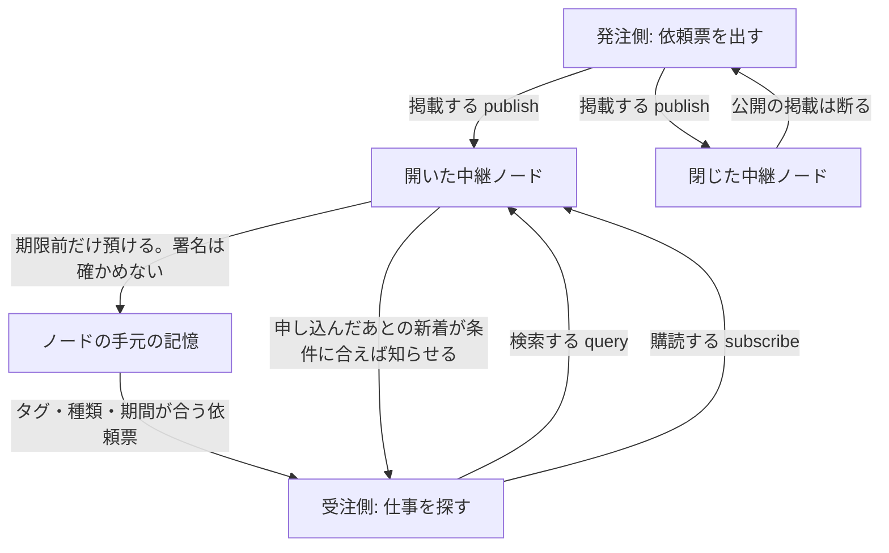

# 依頼票の配り方

このページは、仕事の依頼票がどう届くかを説明します。エンジニアでなくても読めるように書いてあります。

ここで動くのは、一台のプログラムの中だけです。インターネットには出しません。画面もありません。中継のノードは、署名を確かめません。

## 依頼票は、掲示板の紙

依頼票は、仕事の条件を書いた紙です。出す人は、同じ紙を何台かの中継ノードに渡せます。ノードは紙を預かって、探している人に渡すだけです。誰が仕事を受けるかは、ノードは決めません。

紙には、探すための付箋が付きます。付箋は「名前」と「値」の組です。たとえばスキル、地域、言語です。知らない種類の紙や、知らない付箋も、捨てずに預かります。期限が来た紙だけ捨てます。

## 三つの操作

- **掲載（publish）**: 開いたノードだけが、外からの依頼票を預かります。同じ紙をもう一度出しても、一枚のままです。中身が違う紙を、同じ番号で出すことは断ります。閉じたノードは、公開の掲載を断ります。
- **検索（query）**: 付箋、種類、期間を指定して、今預かっている紙を探します。付箋の名前が違う条件は、全部そろった紙だけが残ります。同じ名前の中では、どれか一つ合えば残ります。
- **購読（subscribe）**: 申し込んだあとに新しく届いた紙のうち、条件に合うものだけ知らせます。申し込む前から預かっている紙は、検索で見ます。

最初の記憶は、プログラムを止めると消えるメモリです。置き場はアダプタ側にあり、ノード本体は置き場の作り方を知りません。これで、あとから別の置き場へ取り替えられます。

## 中継のノードは署名を確かめない

依頼票やメッセージには、送ったエージェントの署名（`sig`）が付きます。中継のノードは、それを確かめずに、そのまま保管します。プログラムは「ノードでは確認していない」（`deferred`）と記録します。番号（`id`）は、呼び出し側が付けた仮の値で、本文から計算していません。

署名は、受け取る側のエージェントと `@ix/verify` が、送り主の `did:key` で確かめ、合わないものは受け付けません。文章を揃える手順（JCS）と、そこから作る指紋（SHA-256）で、交渉のメッセージは指紋の鎖につながり、これも同じ側が確かめます。ノードが保管したことを、署名が確かめ済みという意味に読まないでください。

## 拡張の名乗り

交渉に使う拡張は四つです。受注側は、使いたい拡張の名前を `A2A-Extensions` という見出しに並べて送ります。発注側は、自分も持っているものだけを、同じ見出しで返します。

交渉を有効にするには、委任・承認・履歴の三つも、同じ名乗りに入っている必要があります。一つでも欠けていれば、交渉だけは有効にしません。相手が別の版を名乗っても、こちらの版で代わりに受けません。知らない名前は無視します。

この名乗りは、メッセージを実際にインターネットへ送る機能ではありません。見出しの文面を読み、返す文面を決めるところまでです。公式の適合テストは、4項目が範囲つきで合格、2項目が未実施です。到達点は [`feature-map.md`](feature-map.md) です。

## まだできないこと

- インターネットにポートを開いて、外のコンピュータと話すこと。手元だけの試し方は [`docs/local-trial.md`](local-trial.md) です。その試しは `127.0.0.1` だけを聞き、外には公開しません。
- 中継のノードが署名を確かめること。確かめるのは、双方のエージェントと `@ix/verify` です。
- 中継の番号（`id`）を本文のハッシュとして計算すること。
- 閉じたノードへ、社内専用の口から依頼票を入れること。検索は、すでに入っている紙があれば返せます。入れる専用の口は、まだありません。
- 適合テストを、6項目すべて合格にすること。いま合格なのは、範囲つきの4項目だけです。1と2は未実施です。
