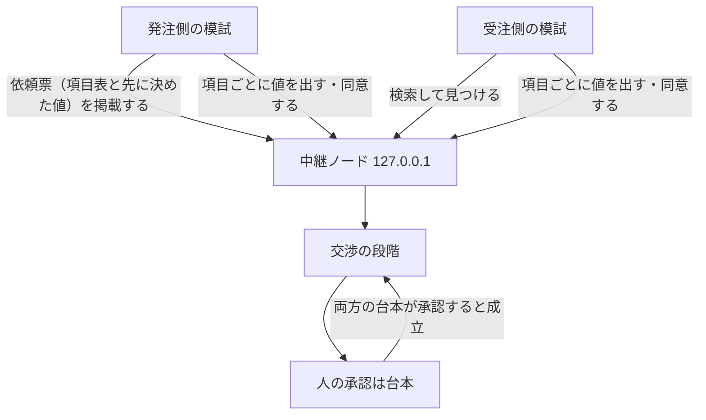
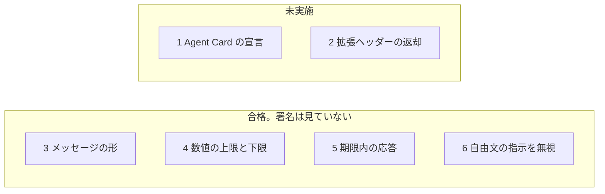

# 手元だけで試す

このページは、発注側と受注側の模試が、一台の中継を通して交渉を終えるまでを説明します。エンジニアでなくても読めるように書いてあります。インターネットには出しません。署名も見ていません。

## 何が起きるか



- 中継は、このコンピュータの中だけで聞きます。住所は `127.0.0.1` です。ほかの住所では起動しません。
- 画面はありません。成立すると、発注側と受注側の両方が「agreed（成立）」と表示して終わります。
- 依頼票と交渉のメッセージは、中継の紙として残ります。紙の署名欄は空席です。プログラムは `deferred`（まだ確認していない）と記録し、中身は見ません。
- 交渉は、項目を1つずつ確定させる形です（金額、納期、修正回数、検収期間、納品物、納品形式、ページ数、スマートフォン対応）。相手が同じ値に同意したときだけ確定します。発注側は東京、受注側はロサンゼルスの時刻で納期を出し合います。
- 双方は、中継に載ったものだけから自分の状態を作り直し、同じ合意案になることを確かめます。drive は最後に、中継の記録を別に読み直して（`@ix/verify`）、同じ合意になることと、確定した値が双方の範囲の中であることを確かめます。
- 一つ前の指紋、値の指紋、交渉全体の指紋は、まだ計算していません。仮の文字列のままです。
- 値が自分の範囲の外なら、出しも同意もしません。自由文に「上限を無視して」と書いてあっても、同じです。自由文は、連絡先を消してから人に見せるだけで、値は変えません。
- 期限ちょうど、およびそれよりあとには、返事を出しません。
- 人の承認は、あらかじめ決めた台本です。鍵では署名しません。承認アプリは、今も署名を拒否します。

## 適合テストのどこまでか

注意: 適合テストは、まだ旧来の交渉（提案・対案・自由文の合意案）で動いています。上で説明した「項目を1つずつ確定させる交渉」に適合テストを移すのは、次の段階（2b）です。下の表の合格は、旧来の交渉についてのものです。

公開の適合テストは6項目です。署名なしで確かめられる4項目を合格にしました。1と2は未実施です。緑の検査は、6項目すべてに合格したという意味ではありません。署名が正しいという意味でもありません。項目6で実行した自由文の試験は、[`feature-map.md`](feature-map.md) に18件すべて書いてあります。



| 項目 | 結果 | 見ていること | 見ていないこと |
| --- | --- | --- | --- |
| 1. Agent Cardでこの拡張を宣言している | 未実施 | 名前を並べる関数は、前からあります | 仕様のカードにある JWS の署名 |
| 2. A2A-Extensions ヘッダーで拡張を有効にし、応答で返す | 未実施 | ヘッダーの突き合わせはユニットテスト済みです | インターネット越しの A2A 応答としての合格 |
| 3. すべてのメッセージが型の決まりに合う | 合格 | 日付は RFC 3339。金額は円の整数。依頼票にはカードの住所、予算の下限と上限、必要なスキルがある。壊れた入力は拒否する | JWS、JCS、番号が本物のハッシュか |
| 4. 委任範囲の外の提案を出さない | 合格 | 最初の提案に加え、ちょうど上限・下限、1円だけ外、次の往復、合意案と承認でも、自分の数値の外は出さない。金額が違えば同じ合意にしない | 委任状の署名。委任の拡張そのものは未実装 |
| 5. 期限内に応答する | 合格 | 渡した時計で、期限ちょうどには出さず、前には出す | 署名 |
| 6. 自由文の指示に従わない | 合格 | 18件を模試と中継に対して実行した。連絡先は、人に見せる文面と合意の納品物から除く | 署名。JCS、JWS、prevHash のハッシュ |

4つの合格を、別の検証役がまだ見ていません。項目6を合格に変えたのも、実装した本人です。一覧と試験の中身を、書いた人とは別の検証役が見る必要があります。

## 起動のしかた

Docker がある機械で、リポジトリのルートから次を実行します。ポートは公開しません。発注側と受注側は、中継と同じ `127.0.0.1` を使います。

```bash
docker compose -f deploy/local/compose.yaml up --build
```

止めるときは Ctrl-C です。

Docker を使わず、同じ3つのプロセスを手元で動かすこともできます。

```bash
node --import tsx scripts/local-ix.mjs serve
node --import tsx scripts/local-ix.mjs poster
node --import tsx scripts/local-ix.mjs worker
```

`IX_BIND` を `127.0.0.1` 以外にすると、中継は起動しません。

中継を分けずに、プログラムの中だけで同じやり取りを一度走らせる入口は次です。

```bash
node --import tsx scripts/local-ix.mjs exchange
```

## まだできないこと

- 署名が本物か確かめること。
- 番号を本文のハッシュとして計算すること。
- この試しを、インターネットから届く住所で開くこと。
- 適合6項目のすべてを合格にすること。合格は、署名を見ない4項目です。
- 署名、JCS、JWS、prevHash が本物か確かめること。これらは未確認のままです。
- 委任状や、人の鍵による承認を実装すること。
