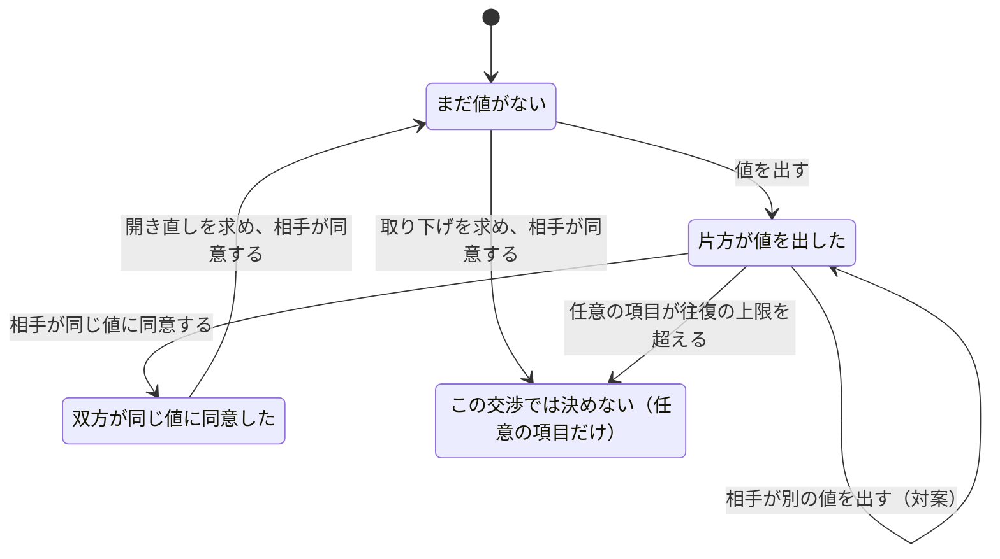
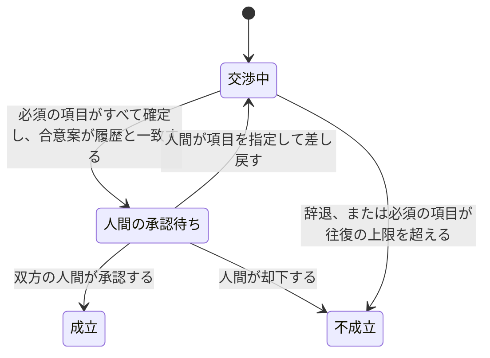

# 交渉の進み方

このページは、仕事の条件を決めるときの進み方を説明します。エンジニアでなくても読めるように書いてあります。仕様は [`spec/term-protocol-draft.md`](spec/term-protocol-draft.md) です。模試のエージェントと模試の人間の署名、指紋の鎖は、双方と `@ix/verify` が確かめます。本物の人が使う承認アプリは、まだありません。手元で試す方法は [`local-trial.md`](local-trial.md) です。

## 登場人物

- **発注側**: 仕事を頼む側です。人と、その人の代わりに条件をやり取りする係（エージェント）がいます。
- **受注側**: 仕事を受ける側です。同じように、人と係がいます。
- **人間**: 最後に「この条件でよいか」を決める本人です。係は、この決裁をしません。

## 項目ごとの状態

決める項目（金額、納期、修正回数、検収期間、納品物、納品形式など）は、仕事の種類ごとの「項目表」で決まります。項目は1つずつ、次の状態を進みます。

- 自分で出した値に、自分で同意することはできません。
- 項目を足す・取り下げる・開き直すには、相手の同意が要ります。相手は、その頼みだけを断れます（`TermRefuse`）。
- 往復の上限は項目ごとに数えます。必須の項目が上限を超えると、交渉全体が不成立になります。

## 交渉全体の段階

- 合意案は、確定した項目の一覧です。双方の係が、交渉の記録から同じ合意案を作れたときだけ、人間の承認に進みます。
- 依頼票の期限ちょうど、およびそのあとには、どちらの係も交渉しません。交渉の途中で期限になれば、そこで止まります。今の模試では、止まったときに状態は「交渉中」などのまま残り、止まった理由は断りの記録に残ります。
- 自由文（依頼の説明やメモ）は、人が読むためのものです。係は自由文で値を変えません。人に見せる前に連絡先を消します。
