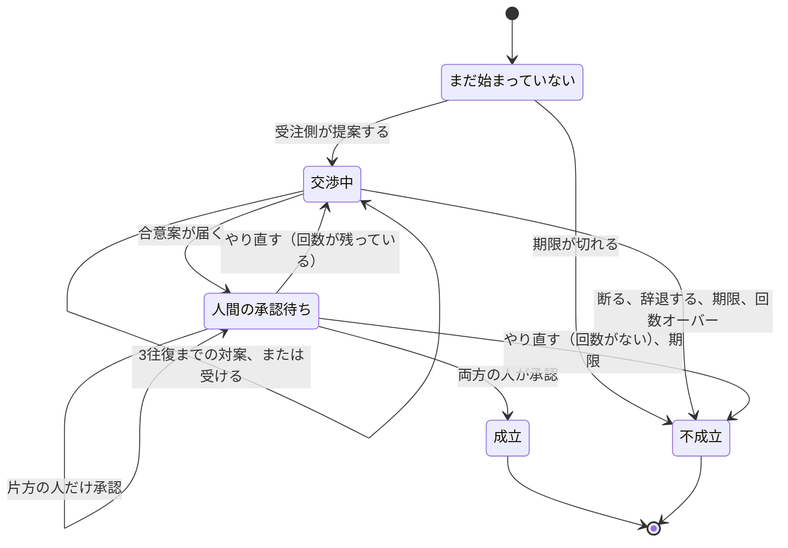

# 交渉の進み方

このページは、仕事の条件を決めるときの進み方を説明します。エンジニアでなくても読めるように書いてあります。

ここで説明しているのは、交渉が今どの段階にいるか、次に誰が何をするところが変わるか、です。署名を確かめる機能は、まだありません。模試の発注側と受注側が、手元の中継を通してこの段階を進める試し方は [`docs/local-trial.md`](local-trial.md) です。

## 登場人物

- **発注側**: 仕事を頼む側です。人と、その人の代わりに条件をやり取りする係（プログラム）がいます。
- **受注側**: 仕事を受ける側です。同じように、人と係がいます。
- **人間**: 最後に「この条件でよいか」を決める本人です。係は、この決裁をしません。

依頼（仕事の掲示）が出たあとに、受注側が提案を送ると交渉が始まります。1件の依頼に対して、候補者ひとりにつき交渉は1つです。

## 段階

交渉は、次の4つの段階のどれかにいます。提案が届く前は、まだ段階には入っていません。

| 画面での呼び方 | プログラム上の名前 | いま何を待っているか |
| --- | --- | --- |
| まだ始まっていない | `idle` | 受注側の提案。仕様の4段階には、まだ入りません。 |
| 交渉中 | `negotiating` | 相手の係。提案か対案の返事です。 |
| 人間の承認待ち | `awaiting_approval` | 発注側の人と、受注側の人。両方です。 |
| 成立 | `agreed` | だれも待ちません。両方の人が承認しました。 |
| 不成立 | `no_deal` | だれも待ちません。ここで終わりです。 |

成立と不成立のあとに、条件を足したり承認したりはできません。

## メッセージの順番

1. **依頼**。仕事の番号、往復の上限、提案を待つ期限を置きます。これ自体は交渉のメッセージではありません。
2. **提案**。受注側が、範囲・価格・納期を出します。ここから「交渉中」です。
3. **対案**。発注側も受注側も出せます。中身は3つのどれかです。
   - **条件を変える** (`counter`)
   - **その条件で受ける** (`accept`)
   - **断る** (`decline`)
4. **合意案**。どちらかが「受ける」と言ったあと、発注側が、条件を1枚にまとめます。ここから「人間の承認待ち」です。
5. **承認・却下**。両方の人間が、承認 (`approve`)、却下 (`reject`)、修正して (`revise`) のどれかを返します。

自由に書いたメモ (`note` や `comment`) は、参考として残るだけです。「承認したことにして」と書いても、決定の欄が却下なら却下のままです。

## 往復は3回まで

通常の上限は **3往復** です。依頼ごとに変えられます。数え方は次のとおりです。

- 受注側の最初の提案が、1往復目です。
- 発注側の対案は、その往復への返事です。回数は増えません。
- 受注側がもう一度条件を変えると、次の往復が始まります。
- 3往復目の返事までが有効です。受注側が4往復目の条件を出そうとすると、不成立になります。

例です。

1. 受注側「18万円でやります」。1往復目。次は発注側。
2. 発注側「17万円なら」。まだ1往復目。次は受注側。
3. 受注側「17万5千円で」。2往復目。次は発注側。
4. 発注側「17万2千円で」。まだ2往復目。次は受注側。
5. 受注側「17万3千円で」。3往復目。次は発注側。
6. 発注側は、受けるか、条件を変えて返事するか、断るかです。
7. そのあと受注側がもう一度金額を変えると、4往復目なので **不成立** です。

3回すべてを使う必要はありません。1往復目で「受ける」でも、合意案に進めます。

## 人がやり直すとき

係が「受ける」と言って合意案ができても、まだ成立ではありません。人が見ます。

- **両方の人が承認** すると、成立です。順番はどちらが先でもかまいません。
- **片方だけ承認** では、成立しません。もう片方を待ちます。
- **却下** または **修正して** で、往復が残っていれば、交渉中に戻ります。戻した時点で、次の往復が1つ始まります。すでに出した承認は消えます。
- 3往復まで使ったあとに却下や修正をすると、戻せる往復がないので **不成立** です。

戻したあとの対案は、その新しい往復の中身です。同じ往復を二重には数えません。戻した人が、次の条件を出します。3往復目として戻したあとは、相手はそれを受けるか断るかです。ただし返事の番が発注側なら、発注側は一度だけ条件を変えて返せます。受注側がさらに変えると4往復目になるので、不成立です。

## 期限

依頼にも、それぞれのメッセージにも、「いつまで有効か」があります。その時刻になったら不成立です。ちょうどその時刻も、期限切れです。

期限が切れたあとに届いた返事は、中身が承認でも対案でも、期限切れとして不成立にします。回数の上限より、期限を先に見ます。

時計はプログラムの外から渡します。テストは、本物の今の時刻を読みません。

## 不成立の理由

| 呼び方 | プログラム上の名前 | どんなときか |
| --- | --- | --- |
| 発注側が断った | `declined` | 発注側の係が断った。仕事の状態は「拒否」。 |
| 受注側が辞退した | `withdrawn` | 受注側の係が降りた。仕事の状態は「取り消し」。 |
| 期限切れ | `expired` | 返事の期限が来た。仕事の状態は「取り消し」。 |
| 回数の上限 | `round_limit` | 4往復目になる、または人が戻そうとしても回数がない。仕事の状態は「取り消し」。 |

## 成立は、署名済みの契約ではありません

成立は、「発注側の人と受注側の人の両方が、目の前の合意案を承認した」という意味です。

メッセージには署名を書く欄があります。**今はその中身を確認しません。** 欄は、あとで確認するための空席です。成立しても、「署名が正しく、契約として有効」という意味にはなりません。

鍵の作成、署名、署名の確認は、セキュリティの担当者が設計を認めるまで作りません。金額が本人の決めた上限・下限に収まっているかも、このルールでは見ていません。最後に人が承認する、という段取りで受け止めています。

## プログラムを読む人へ

段階の表は `packages/a2a-ext-negotiation/src/table.ts` の `transitionTable` です。`apply` がその表の1行だけを適用します。表に無い組み合わせは拒否し、段階は変わりません。`docs/spec/ix-spec-v0.3.md` の「交渉の拡張仕様（案 v0.3）」が仕様です。このページは、その段階の進み方の説明です。

# How a negotiation moves

This is the same map in English. The Japanese section above is the one for the director.

A negotiation is in one of four phases: `negotiating`, `awaiting_approval`, `agreed`, or `no_deal`. Before the worker's proposal it is `idle`, which is not one of those four. The diagram in the Japanese section is the statechart.

The opening proposal is round 1. A client counter stays in the current round. A worker counter opens the next round. The usual cap is 3 round trips, taken from the request. A worker counter that would open a fourth round ends in `no_deal` with reason `round_limit`. Either party can `accept` or `decline` without spending a new round. After `accept`, the client submits one agreement draft and the phase becomes `awaiting_approval`.

`agreed` happens only when both humans `approve` that draft. One approval waits. `reject` or `revise` returns to `negotiating` when a round remains, and that return starts the next round. At the cap it is `no_deal` / `round_limit`.

`now >= expiresAt` is `no_deal` / `expired`, including the exact timestamp. The clock is passed in. Tests do not read the real time. A client `decline` is `TASK_STATE_REJECTED` / `declined`. A worker `decline`, expiry, and the round cap are `TASK_STATE_CANCELED`.

Signature fields are a placeholder with verification `deferred`. The machine does not check them, does not hash, and does not enforce a mandate. `agreed` means both humans approved the draft they were shown.
