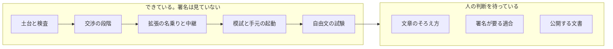
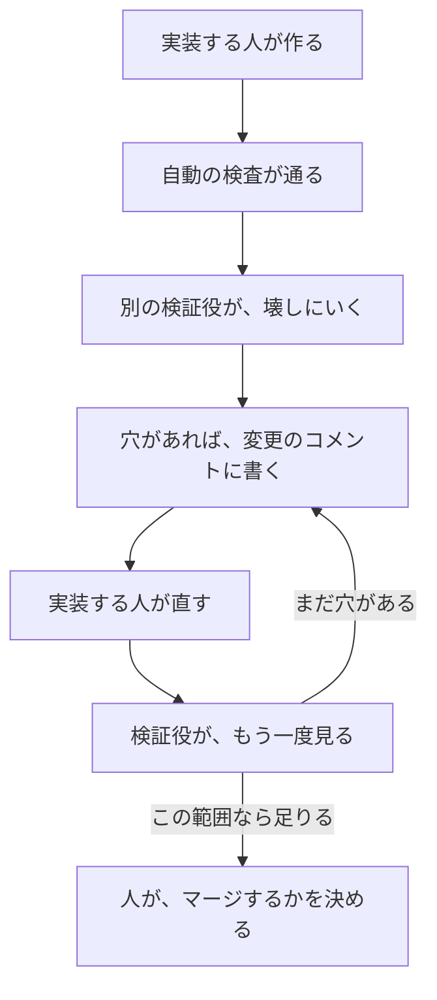

# ここまでの振り返り

このページは、IX をここまで作ってきた記録です。エンジニアでなくても読めるように書いてあります。署名が正しい、という話ではありません。

## 何を作ったか

土台から、手元の中継、模試、自由文の試験まで来ました。インターネットには出していません。署名も見ていません。

| 段階 | 入った変更 | できるようになったこと |
| --- | --- | --- |
| T01 | 最初の土台 | パッケージの分かれ方、検査の入口、署名はまだ作らない、という決まり |
| T02 | 検査が自分で壊れることの確認 | 禁止した書き方が、見本では失敗し、本物の木では通ること |
| T08 | [PR #5](https://github.com/ranma-s/a2aix/pull/5) | 交渉の段階。提案、対案、合意案、人の承認と却下、3往復、期限。時計は外から渡す。署名欄は空席 |
| T09・T10 | [PR #6](https://github.com/ranma-s/a2aix/pull/6) | 拡張の名乗り。依頼票の掲載・検索・購読。最初の置き場はメモリ。開いたノードだけが掲載を受ける。署名は見ない |
| T11・T14 | [PR #7](https://github.com/ranma-s/a2aix/pull/7) | 発注側と受注側の模試。手元の `127.0.0.1` だけで交渉を最後まで進める。適合の3、4、5を、署名を見ない範囲で合格にした |
| T12・T15 | [PR #8](https://github.com/ranma-s/a2aix/pull/8) | 自由文の指示を無視する試験。署名を見ない検査。検証の手順が手元の中継と模試を起動し、証拠を残して止める。毎晩の検査 |

T13 は、署名が要る作業です。まだ始めていません。

## 検証のしかた

実装した人と、壊しにいく人は、別です。同じ実行で両方はやらせません。

自動の検査が緑でも、完了にはしません。検証役は、書いた人の説明をそのまま信じず、中継に文が届いているか、金額が外に出ていないか、連絡先が残っていないかを見ます。最後にマージするのは人です。

## 検証役が見つけた穴

### PR #7

合意の番号が、金額と結びついていませんでした。あとから別の金額の合意を、同じ番号で通せる余地がありました。日付や依頼票の必須項目も、仕様よりゆるいところがありました。

直したあとは、金額が番号の文字に入り、違えば同じ合意として受けません。日付は暦として読み、依頼票にはカードの住所、予算の下限と上限、必要なスキルが要ります。署名は、今も見ていません。

### PR #8

自由文の試験のうち、期限の1件は、時計が最初から期限ちょうどでした。命令の文は中継に載らず、人に見せる文面も空でした。止まった理由は、文を読んだからではなく、時計が先に止めただけでした。

連絡先の削除は、普通のメールと、ハイフン付きの電話と、一部の国番号だけでした。空白や点で区切った電話、括弧つきの電話、HTML の書き方で隠したメールは残っていました。題名、必要なスキル、納品物、通貨、相手の差し替えは、試験が触っていませんでした。納品物に書いたメールは、合意の型に残っていました。

直したあとは、期限の前とあとで、命令の文が中継に載ります。期限のあとは、その文を読んだうえで返事を出しません。連絡先の削除は、空白、点、括弧、HTML の書き方、全角、隠した書き方、見えない文字まで広げ、人に見せる文面のすべてにかけます。金額や日付や予算の数字は、消しません。題名、スキル、納品物、通貨、相手の差し替えも、試験に入っています。

この直しも、書いた本人の報告だけでは完了にしません。別の検証役が、もう一度見る必要があります。

## まだできていないこと

- 文章のそろえ方と、そこから作る番号。未マージの [PR #3](https://github.com/ranma-s/a2aix/pull/3) にあります。人間のセキュリティ担当者が受け入れるまで、マージしません。
- T13 と、適合の1と2。Agent Card の署名と、インターネット越しの拡張ヘッダーです。署名の確認が先です。
- Docker のまとめ起動。ファイルはあります。この環境では、実際には一度も起動していません。検証が起動するのは、Docker ではなく、同じコンピュータの中の手続きです。
- 公開に向けた文書。[PR #4](https://github.com/ranma-s/a2aix/pull/4) は、まだ人が決めていません。
- 公開の直前にやること。履歴から個人のメールアドレスを消すこと。古いアカウント名を、いまの `ranma-s` にそろえること。非公開で脆弱性を受け取れるようにすること。コミュニティに、見てほしいと頼むこと。

## 分かったこと

- 緑の検査は、その検査が書いた範囲だけです。6項目すべての合格でも、署名が正しいという意味でもありません。
- 検証役は、説明文ではなく、中継に残った紙と、人に見せる文面を見ます。
- 期限の試験は、命令の文が届いてからでないと、時計が先に止めただけになります。
- 連絡先は、よくある形だけ消しても漏れます。金額や日付まで消さないことも、同じくらい大事です。
- 署名、鍵、文章のそろえ方は、人が中身を見るまで進めません。

## 次にすること

1. セキュリティ担当者に、PR #3 を見てもらう。見るまでマージしない。
2. そのあとで、適合の1と2、そして T13 に進む。署名が要るので、先には進まない。
3. Docker のまとめ起動を、実際に一度動かして、ポートを外に出していないことを見る。
4. PR #4 を、公開する文書として人が引き受けるか決める。
5. 公開の直前に、履歴の個人のメールアドレスを消し、アカウント名を `ranma-s` にそろえ、非公開の脆弱性報告を開き、コミュニティに見てほしいと頼む。
